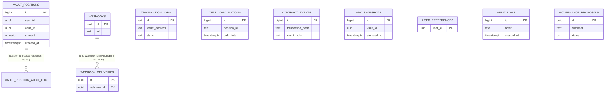

# Aura Vault — PostgreSQL Data Dictionary

This document describes the requested application data entities. Implemented structures below are checked against `backend/migrations/`; entities marked **planned** do not have a migration yet and their column lists are a proposed design, not deployed schema.

---

## Schema Overview

```
aura_vault (database)
└── public (schema)
    ├── vault_positions              — current and historical user vault positions
    └── vault_position_audit_log     — immutable append-only audit trail for vault_positions
```

**Migration files:**

| File | Description |
|------|-------------|
| `001_create_vault_positions.sql` | Creates `vault_positions`, `vault_position_audit_log`, indexes, triggers, and audit functions |

---

## Table: `vault_positions`

Stores one row per active or deactivated user position in a vault. A "position" represents a user's aggregate holding in a specific vault at a given point in time — it is not a ledger of individual transactions. Soft deletion via `deleted_at` preserves historical data for auditing and analytics.

### Columns

| Column | Type | Nullable | Default | Description |
|--------|------|----------|---------|-------------|
| `id` | `BIGSERIAL` | NOT NULL | auto-increment | Synthetic primary key. Stable surrogate used for joins and audit log references. Never reused or recycled even after soft-delete. |
| `user_id` | `UUID` | NOT NULL | — | Identifies the vault participant. Maps to an application-layer user record (wallet address or auth identity). UUID chosen to avoid sequential ID enumeration in API responses. |
| `vault_id` | `UUID` | NOT NULL | — | Identifies the vault contract instance. Allows the schema to support multiple vault deployments (mainnet, testnet, strategy variants) in a single database. |
| `amount` | `NUMERIC(38, 18)` | NOT NULL | — | The user's current underlying token holdings in this vault, stored with 18-decimal precision to match SEP-41/ERC-20 token semantics. Always ≥ 0 (enforced by `CHECK`). |
| `entry_date` | `TIMESTAMPTZ` | NOT NULL | `NOW()` | Timestamp when the user first entered this vault position. Used as the start date for yield calculations. Stored with timezone to avoid DST ambiguity. |
| `entry_price` | `NUMERIC(38, 18)` | NOT NULL | — | The vault share-to-underlying exchange rate at the time of the initial deposit. Used for cost-basis and PnL reporting. Always ≥ 0 (enforced by `CHECK`). |
| `yield_earned` | `NUMERIC(38, 18)` | NOT NULL | `0` | Cumulative yield earned by this position since `entry_date`, updated by the yield calculation service. Does not include unrealised exchange-rate appreciation. Always ≥ 0. |
| `created_at` | `TIMESTAMPTZ` | NOT NULL | `NOW()` | Row insertion timestamp. Set once and never changed; used for data lineage and event replay ordering. |
| `updated_at` | `TIMESTAMPTZ` | NOT NULL | `NOW()` | Timestamp of the most recent UPDATE. Automatically maintained by the `trg_vault_positions_updated_at` trigger — **do not set this column manually** in application code. |
| `deleted_at` | `TIMESTAMPTZ` | NULL | `NULL` | Soft-delete timestamp. `NULL` = active position. Set to `NOW()` on logical deletion (e.g., full withdrawal). Rows are never physically deleted; this preserves the audit trail and enables recovery. |

### Constraints

| Name | Type | Expression | Rationale |
|------|------|-----------|-----------|
| `vault_positions_pkey` | PRIMARY KEY | `id` | Unique row identifier |
| _(inline)_ | CHECK | `amount >= 0` | A negative holding is economically impossible; reject at the DB layer to prevent data corruption from application bugs |
| _(inline)_ | CHECK | `entry_price >= 0` | Entry price is always non-negative |
| _(inline)_ | CHECK | `yield_earned >= 0` | Yield cannot be negative; losses are expressed via reduced `amount` not negative yield |

### Relationship Diagram

```
vault_positions
  └── vault_position_audit_log
        FK: audit_log.position_id → vault_positions.id
        (NOT enforced as a foreign key constraint to allow audit records to
         survive even if vault_positions rows were ever hard-deleted)
```

---

## Table: `vault_position_audit_log`

An immutable, append-only audit trail that records every INSERT, UPDATE, and DELETE applied to `vault_positions`. Rows in this table are written by the `trg_vault_positions_audit` trigger and must never be modified or deleted by application code.

### Columns

| Column | Type | Nullable | Default | Description |
|--------|------|----------|---------|-------------|
| `id` | `BIGSERIAL` | NOT NULL | auto-increment | Audit log entry primary key. Monotonically increasing; safe to use as an ordering cursor for event replay. |
| `position_id` | `BIGINT` | NOT NULL | — | References `vault_positions.id`. Not a foreign key constraint (intentional — see Rationale below) so audit records survive even if source rows are purged. |
| `operation` | `TEXT` | NOT NULL | — | The DML operation that triggered this record: one of `'INSERT'`, `'UPDATE'`, `'DELETE'`. Validated by a `CHECK` constraint. |
| `changed_at` | `TIMESTAMPTZ` | NOT NULL | `NOW()` | Wall-clock timestamp when the triggering DML ran. Separate from `vault_positions.updated_at` to capture the exact audit moment. |
| `changed_by` | `UUID` | NULL | `NULL` | Application-level identity of the actor that caused the change (e.g., API user ID). `NULL` when the change originates from a background job or migration with no user context. |
| `before_state` | `JSONB` | NULL | `NULL` | Full row snapshot before the change, serialised as JSONB by `to_jsonb(OLD)`. `NULL` for INSERT operations (no prior state exists). |
| `after_state` | `JSONB` | NULL | `NULL` | Full row snapshot after the change, serialised as JSONB by `to_jsonb(NEW)`. `NULL` for DELETE operations (no resulting state). |

### Constraints

| Name | Type | Expression |
|------|------|-----------|
| `vault_position_audit_log_pkey` | PRIMARY KEY | `id` |
| _(inline)_ | CHECK | `operation IN ('INSERT', 'UPDATE', 'DELETE')` |

**Why no foreign key on `position_id`?** Foreign key enforcement would prevent audit records from surviving a hard-delete of the source row. Even though the application uses soft-delete, the audit log is designed to be independently durable. If regulatory requirements ever require hard deletion (e.g., GDPR erasure), the audit record is retained as evidence of what was deleted.

---

## Indexes

### On `vault_positions`

| Index Name | Columns | Partial? | Purpose |
|------------|---------|----------|---------|
| `vault_positions_pkey` | `id` | No | Primary key lookup |
| `idx_vault_positions_user_id` | `user_id` | No | Fetch all positions for a single user. Used by portfolio API (`GET /api/v1/user/portfolio`). Without this index the query would scan the entire table. |
| `idx_vault_positions_vault_id` | `vault_id` | No | Fetch all positions in a specific vault. Used by admin dashboards and analytics queries aggregating vault-level stats. |
| `idx_vault_positions_created_at` | `created_at DESC` | No | Time-ordered scans for data backfills, audit queries, and batch yield calculation jobs that process records in insertion order. |
| `idx_vault_positions_user_id_created_at` | `(user_id, created_at DESC)` | Yes — `WHERE deleted_at IS NULL` | Composite covering index for the most common application query: "give me this user's active positions, newest first." The partial filter eliminates soft-deleted rows, keeping the index small. Used by `GET /api/v1/user/portfolio`. |
| `idx_vault_positions_vault_id_created_at` | `(vault_id, created_at DESC)` | Yes — `WHERE deleted_at IS NULL` | Composite index for vault-level queries on active positions. Used by harvest/yield processing that scans all live positions in a vault. |

### On `vault_position_audit_log`

| Index Name | Columns | Purpose |
|------------|---------|---------|
| `vault_position_audit_log_pkey` | `id` | Primary key |
| `idx_vault_position_audit_log_position_id` | `(position_id, changed_at DESC)` | Retrieve the full audit history for a single position ordered by most-recent-first. Used by compliance and support tooling. |

---

## Triggers

### `trg_vault_positions_updated_at`

| Attribute | Value |
|-----------|-------|
| Table | `vault_positions` |
| Timing | `BEFORE UPDATE` |
| Granularity | `FOR EACH ROW` |
| Function | `touch_vault_positions_updated_at()` |

Sets `NEW.updated_at = NOW()` on every UPDATE, ensuring the column always reflects the true last-modification time regardless of what the application code passes. Application code must not include `updated_at` in its UPDATE statement.

### `trg_vault_positions_audit`

| Attribute | Value |
|-----------|-------|
| Table | `vault_positions` |
| Timing | `AFTER INSERT OR UPDATE OR DELETE` |
| Granularity | `FOR EACH ROW` |
| Function | `audit_vault_positions()` |

Records a row in `vault_position_audit_log` for every mutation:

- **INSERT** → `before_state = NULL`, `after_state = to_jsonb(NEW)`
- **UPDATE** → `before_state = to_jsonb(OLD)`, `after_state = to_jsonb(NEW)`
- **DELETE** → `before_state = to_jsonb(OLD)`, `after_state = NULL`

The `changed_by` column is always `NULL` in the current implementation (the trigger does not have access to the application-layer user identity). To populate it, the application layer should `SET LOCAL app.current_user_id = '<uuid>'` inside a transaction before performing the DML, and the trigger function updated to read `current_setting('app.current_user_id', true)`.

---

## Functions

### `touch_vault_positions_updated_at()`

```sql
RETURNS TRIGGER AS $$
BEGIN
  NEW.updated_at = NOW();
  RETURN NEW;
END;
$$ LANGUAGE plpgsql;
```

Called by `trg_vault_positions_updated_at`. Returns the modified row with `updated_at` set to the current transaction time.

### `audit_vault_positions()`

```sql
RETURNS TRIGGER AS $$
BEGIN
  -- Inserts one row into vault_position_audit_log per DML event
  -- Handles INSERT, UPDATE, DELETE via TG_OP branching
END;
$$ LANGUAGE plpgsql;
```

Called by `trg_vault_positions_audit`. Dispatches on `TG_OP` and writes the appropriate before/after JSONB snapshots.

---

## Column Type Rationale

| Type | Used For | Why |
|------|----------|-----|
| `BIGSERIAL` | `id` columns | Auto-incrementing 8-byte integer; supports billions of rows without overflow |
| `UUID` | `user_id`, `vault_id`, `changed_by` | Globally unique, avoids sequential enumeration, compatible with distributed ID generation |
| `NUMERIC(38, 18)` | `amount`, `entry_price`, `yield_earned` | Arbitrary-precision decimal matching 18-decimal token amounts used in Stellar/Soroban contracts. `FLOAT` would introduce rounding errors in financial calculations |
| `TIMESTAMPTZ` | All timestamp columns | Timezone-aware; unambiguous across DST transitions and multi-region deployments |
| `TEXT` | `operation` | Flexible string with `CHECK` constraint; avoids enum type migration friction |
| `JSONB` | `before_state`, `after_state` | Binary JSON with indexing support; preserves full row state for point-in-time recovery and compliance |

---

## Example Queries

### Fetch all active positions for a user

```sql
SELECT id, vault_id, amount, entry_date, entry_price, yield_earned
FROM vault_positions
WHERE user_id = $1
  AND deleted_at IS NULL
ORDER BY created_at DESC;
```

Uses index: `idx_vault_positions_user_id_created_at`

### Fetch audit history for a specific position

```sql
SELECT operation, changed_at, changed_by, before_state, after_state
FROM vault_position_audit_log
WHERE position_id = $1
ORDER BY changed_at DESC;
```

Uses index: `idx_vault_position_audit_log_position_id`

### Soft-delete a position

```sql
UPDATE vault_positions
SET deleted_at = NOW()
WHERE id = $1
  AND deleted_at IS NULL;
```

The `trg_vault_positions_updated_at` trigger automatically sets `updated_at`.
The `trg_vault_positions_audit` trigger records the before/after state.

### Aggregate vault TVL

```sql
SELECT vault_id, SUM(amount) AS total_value_locked
FROM vault_positions
WHERE deleted_at IS NULL
GROUP BY vault_id;
```

Uses index: `idx_vault_positions_vault_id_created_at`

---

## Schema Diagram (ASCII)

```
vault_positions
┌─────────────────────────────────┐
│ id            BIGSERIAL PK      │◄──────────────────────┐
│ user_id       UUID NOT NULL     │                       │
│ vault_id      UUID NOT NULL     │  vault_position_audit_log
│ amount        NUMERIC(38,18)    │  ┌───────────────────────────────┐
│ entry_date    TIMESTAMPTZ       │  │ id           BIGSERIAL PK     │
│ entry_price   NUMERIC(38,18)    │  │ position_id  BIGINT NOT NULL ─┘
│ yield_earned  NUMERIC(38,18)    │  │ operation    TEXT             │
│ created_at    TIMESTAMPTZ       │  │ changed_at   TIMESTAMPTZ      │
│ updated_at    TIMESTAMPTZ       │  │ changed_by   UUID NULL        │
│ deleted_at    TIMESTAMPTZ NULL  │  │ before_state JSONB NULL       │
└─────────────────────────────────┘  │ after_state  JSONB NULL       │
          │                          └───────────────────────────────┘
          │ AFTER INSERT/UPDATE/DELETE
          ▼
  trg_vault_positions_audit
          │
          ▼
  writes to vault_position_audit_log
```

---

## Future Migrations (Planned)

The following columns and tables are anticipated in upcoming migrations based on the application roadmap. This section will be updated when migration files are added.

| Planned Item | Justification |
|---|---|
| `vault_positions.shares` column | Track on-chain share balance separately from token amount for multi-vault support |
| `vault_positions.last_harvest_at` | Support per-position yield accrual calculations |
| `webhooks` table | Persist webhook endpoints currently stored in memory (`backend/src/webhook.ts`) |
| `webhook_deliveries` table | Persist delivery records for retry durability across server restarts |
| `users` table | Formal user record linked to `user_id` UUID for session and auth data |

---

## Maintenance Notes

- **Zero downtime index creation:** Always use `CREATE INDEX CONCURRENTLY` in production migrations to avoid table locks.
- **Backfilling `changed_by`:** To retroactively populate `changed_by` in the audit log, use `SET LOCAL app.current_user_id` in a transaction before DML and update the trigger function to read it via `current_setting('app.current_user_id', true)`.
- **Archival strategy:** Rows in `vault_position_audit_log` accumulate indefinitely. For deployments older than 12 months, consider partitioning `vault_position_audit_log` by `changed_at` year/month and archiving cold partitions to cold storage (e.g., AWS S3 via `pg_partman`).

---

## Application Data Dictionary (Requested Entities)

The issue names `transaction_queue` and `webhook_subscriptions`; the current migrations call these `transaction_jobs` and `webhooks`. Those aliases are documented together below. `apy_snapshots`, `user_preferences`, and `governance_proposals` are **planned** and have no current migration; their entries specify the proposed contract so a future migration can be reviewed against it. There is no claim that planned tables exist in deployed databases.

### Entity map

| Requested entity | Current PostgreSQL name | Status / migration |
|---|---|---|
| `vault_positions` | `vault_positions` | Implemented, `001_create_vault_positions.sql` |
| `transaction_queue` | `transaction_jobs` | Implemented, `002_create_transaction_jobs.sql` |
| `yield_calculations` | `yield_calculations` | Implemented, `004_create_yield_calculations.sql` |
| `contract_events` | `contract_events` | Implemented, `005_create_contract_events.sql` |
| `apy_snapshots` | — | Planned; no migration |
| `user_preferences` | — | Planned; no migration |
| `audit_logs` | `audit_logs` | Implemented, `009_create_audit_logs.sql` |
| `webhook_subscriptions` | `webhooks` | Implemented as `webhooks`, `013_create_webhooks.sql` |
| `governance_proposals` | — | Planned; no migration |

### Implemented tables

Columns in this section are the migration definitions. “No” in the Nullable column means `NOT NULL`; “Yes” means nullable. Primary keys are also non-null.

#### `vault_positions`

See the full column, constraint, trigger, and index reference above. It stores a user's position per vault. `user_id` and `vault_id` are application identifiers and do not have PostgreSQL foreign keys in the current migration.

#### `transaction_queue` (`transaction_jobs`)

Queue records for asynchronous deposit, withdrawal, and claim processing (`002_create_transaction_jobs.sql`). Amounts are text because the queue payload preserves token precision; parse and validate them at the application boundary.

| Column | Type | Nullable | Default / constraint | Purpose and example |
|---|---|---:|---|---|
| `id` | TEXT | No | Primary key | Queue/job identifier, e.g. `job_abc`. |
| `tx_type` | TEXT | No | CHECK: deposit, withdrawal, claim | Requested operation, e.g. `deposit`. |
| `wallet_address` | TEXT | No | — | Stellar wallet address, e.g. `G...`. |
| `amount` | TEXT | No | — | Decimal token amount, e.g. `12.5000000`. |
| `webhook_url` | TEXT | Yes | NULL | Optional callback destination. |
| `status` | TEXT | No | `waiting`; CHECK: waiting, active, completed, failed, dead | Worker lifecycle state. |
| `attempts` | INTEGER | No | `0` | Number of processing attempts. |
| `result` | TEXT | Yes | NULL | Successful result or transaction reference. |
| `error` | TEXT | Yes | NULL | Most recent failure description. |
| `meta` | JSONB | Yes | NULL | Optional structured job context. |
| `created_at` | TIMESTAMPTZ | No | `NOW()` | Enqueue time. |
| `updated_at` | TIMESTAMPTZ | No | `NOW()`; update trigger | Last update; maintained by `trg_tx_jobs_updated_at`. |

Foreign keys: none. Indexes: `idx_tx_jobs_status(status)` supports worker polling by state; `idx_tx_jobs_wallet(wallet_address)` supports wallet history; `idx_tx_jobs_created(created_at DESC)` supports newest-first queue inspection. Example: `SELECT id, tx_type, amount FROM transaction_jobs WHERE status = 'waiting' ORDER BY created_at DESC;`

#### `yield_calculations`

Per-position yield calculation results (`004_create_yield_calculations.sql`). No database foreign key connects `position_id` to `vault_positions.id`; the former is TEXT while the latter is BIGINT.

| Column | Type | Nullable | Default / constraint | Purpose and example |
|---|---|---:|---|---|
| `id` | BIGSERIAL | No | Primary key | Calculation row ID, e.g. 42. |
| `position_id` | TEXT | No | — | Application position identifier. |
| `calc_date` | TIMESTAMPTZ | No | — | Calculation time/window anchor. |
| `daily_yield` | NUMERIC(38,18) | No | CHECK >= 0 | Yield for the calculation period. |
| `total_yield` | NUMERIC(38,18) | No | CHECK >= 0 | Accumulated yield recorded for the position. |
| `effective_apy` | NUMERIC(10,8) | No | CHECK >= 0 | Annualized yield estimate, e.g. 0.12500000. |
| `sources_detail` | JSONB | No | `[]` | Structured breakdown by yield source. |
| `created_at` | TIMESTAMPTZ | No | `NOW()` | Insert time. |

Indexes: `idx_yield_calculations_position_id(position_id, calc_date DESC)` retrieves a position's latest calculations; `idx_yield_calculations_calc_date(calc_date DESC)` supports recent-period scans. Example: `SELECT calc_date, total_yield, effective_apy FROM yield_calculations WHERE position_id = $1 ORDER BY calc_date DESC LIMIT 1;`

#### `contract_events`

Indexed event records ingested from Soroban contracts (`005_create_contract_events.sql`).

| Column | Type | Nullable | Default / constraint | Purpose and example |
|---|---|---:|---|---|
| `id` | BIGSERIAL | No | Primary key | Local event row ID. |
| `ledger_sequence` | BIGINT | No | — | Ledger containing the event. |
| `transaction_hash` | TEXT | No | Unique with event_index | Stellar transaction hash. |
| `event_index` | TEXT | No | Unique with transaction_hash | Event position within a transaction. |
| `contract_id` | TEXT | No | — | Emitting Soroban contract. |
| `event_type` | TEXT | No | — | Event name/type, e.g. `deposit`. |
| `topic` | JSONB | No | `[]` | Serialized event topics. |
| `value` | JSONB | No | `{}` | Serialized event payload. |
| `created_at` | TIMESTAMPTZ | No | `NOW()` | Database ingestion time. |

Foreign keys: none. Constraint `contract_events_transaction_hash_event_index_key` prevents duplicate event positions. Index `idx_contract_events_created_at(created_at DESC)` supports newest-first event feeds. Example: `SELECT ledger_sequence, event_type, value FROM contract_events WHERE contract_id = $1 ORDER BY created_at DESC LIMIT 100;`

#### `audit_logs`

Append-oriented application audit events (`009_create_audit_logs.sql`). Actor and entity identifiers are text to support wallet addresses, service identities, and heterogeneous resource IDs.

| Column | Type | Nullable | Default / constraint | Purpose and example |
|---|---|---:|---|---|
| `id` | BIGSERIAL | No | Primary key | Audit row ID. |
| `actor` | TEXT | No | — | Actor identity, e.g. wallet or service name. |
| `entity_type` | TEXT | No | — | Resource class, e.g. `vault`. |
| `entity_id` | TEXT | No | — | Specific resource identifier. |
| `action` | TEXT | No | — | Operation, e.g. `deposit`. |
| `metadata` | JSONB | No | `{}` | Structured event details. |
| `anchor_hash` | TEXT | Yes | NULL | Tamper-evidence chain hash; NULL until anchored. |
| `created_at` | TIMESTAMPTZ | No | `NOW()` | Event time in the database. |

Foreign keys: none. Indexes: `idx_audit_logs_unanchored(created_at ASC) WHERE anchor_hash IS NULL` supports the anchoring worker; `idx_audit_logs_created_at(created_at ASC)` supports time ranges; `idx_audit_logs_actor_created(actor, created_at DESC)`, `idx_audit_logs_entity_type_created(entity_type, created_at DESC)`, and `idx_audit_logs_entity_id_created(entity_id, created_at DESC)` support filtered histories; `idx_audit_logs_actor_entity(actor, entity_type, entity_id, created_at DESC)` supports the combined filter. Example: `SELECT id, action, metadata FROM audit_logs WHERE actor = $1 ORDER BY created_at DESC LIMIT 50;`

#### `webhook_subscriptions` (`webhooks`)

The implemented subscription registry is named `webhooks` (`013_create_webhooks.sql`). Delivery history is stored separately in `webhook_deliveries`, which references `webhooks.id) with `ON DELETE CASCADE`.

| Column | Type | Nullable | Default / constraint | Purpose and example |
|---|---|---:|---|---|
| `id` | UUID | No | `gen_random_uuid()`; primary key | Subscription identifier. |
| `url` | TEXT | No | — | Destination URL. |
| `secret` | TEXT | No | — | Secret used to authenticate signed deliveries; protect at rest. |
| `event_types` | TEXT[] | No | `{}` | Subscribed event names. |
| `consecutive_failures` | INTEGER | No | `0` | Consecutive failed delivery count. |
| `created_at` | TIMESTAMPTZ | No | `NOW()` | Registration time. |
| `updated_at` | TIMESTAMPTZ | No | `NOW()` | Last update time. |

Foreign keys: none on `webhooks`; child table `webhook_deliveries.webhook_id → webhooks.id` cascades on delete. The migration defines no index on `webhooks`. The child indexes `idx_webhook_deliveries_webhook_id(webhook_id, created_at DESC)` and partial `idx_webhook_deliveries_pending(next_retry_at ASC) WHERE status = 'pending'` support delivery history and retry polling. Example: `SELECT id, url, event_types FROM webhooks WHERE $1 = ANY(event_types);`

### Planned entities (not present in migrations)

The following proposed schemas have no deployed columns, constraints, foreign keys, or indexes yet. They are included to make the requested future data model explicit; migration authors should update this section to match the final DDL.

#### `apy_snapshots` — proposed

| Column | Proposed type | Nullable | Default / purpose |
|---|---|---:|---|
| `id` | BIGSERIAL | No | Primary key. |
| `vault_id` | UUID | No | Vault whose APY is measured. |
| `window` | TEXT | No | Measurement window, e.g. `7d` or `30d`. |
| `apy` | NUMERIC(10,8) | No | Annualized yield estimate. |
| `sampled_at` | TIMESTAMPTZ | No | Snapshot time; default `NOW()`. |

Proposed FK: none until vault IDs are represented by a relational vault registry. Proposed index: `(vault_id, window, sampled_at DESC)` for latest APY by vault/window.

#### `user_preferences` — proposed

| Column | Proposed type | Nullable | Default / purpose |
|---|---|---:|---|
| `user_id` | UUID | No | Primary key; application user identity. |
| `locale` | TEXT | No | Caption/UI locale; default `en`. |
| `theme` | TEXT | No | UI theme; default `system`. |
| `notifications_enabled` | BOOLEAN | No | Notification preference; default TRUE. |
| `updated_at` | TIMESTAMPTZ | No | Last change; default `NOW()`. |

Proposed FK: none until a users table exists. The primary key supports direct lookup by user; no additional index proposed.

#### `governance_proposals` — proposed

| Column | Proposed type | Nullable | Default / purpose |
|---|---|---:|---|
| `id` | UUID | No | Primary key; proposal identifier. |
| `proposer` | TEXT | No | Proposer wallet address. |
| `proposal_type` | TEXT | No | Action category, e.g. `set_fee`. |
| `payload` | JSONB | No | Validated action arguments. |
| `status` | TEXT | No | Lifecycle state; proposed default `pending`. |
| `created_at` | TIMESTAMPTZ | No | Creation time; default `NOW()`. |
| `expires_at` | TIMESTAMPTZ | No | Voting/execution deadline. |
| `executed_at` | TIMESTAMPTZ | Yes | NULL until executed. |

Proposed FK: none. Proposed indexes: `(status, expires_at)` for active proposals and `(proposer, created_at DESC)` for a proposer's history.

### ER diagram



### Naming and type conventions

- Table names are lowercase plural snake_case; columns are lowercase snake_case.
- Use `BIGSERIAL` for local numeric row IDs, UUID for globally generated identifiers, and `TIMESTAMPTZ` for instants.
- Use `NUMERIC` for token amounts and financial rates; do not use floating-point types for money.
- Use JSONB for structured event or metadata payloads, not for values that require relational constraints or frequent filtering.
- Foreign keys are added only where the migration defines them. Names that look related (such as `position_id`) are not automatically enforced relationships.
- Planned entities above are design proposals; deployed schema is defined only by applied migrations.

### Index lookup examples

```sql
-- Queue workers: status filter and newest jobs
SELECT id FROM transaction_jobs WHERE status = 'waiting' ORDER BY created_at DESC;

-- Latest calculation for one position
SELECT * FROM yield_calculations WHERE position_id = $1 ORDER BY calc_date DESC LIMIT 1;

-- Event feed for one contract
SELECT * FROM contract_events WHERE contract_id = $1 ORDER BY created_at DESC LIMIT 100;

-- Pending webhook retry candidates
SELECT id FROM webhook_deliveries WHERE status = 'pending' AND next_retry_at <= NOW()
ORDER BY next_retry_at;
```
